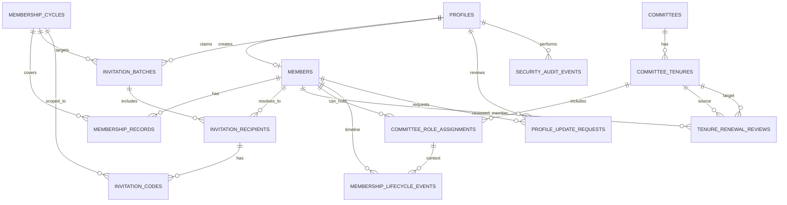

# JnUITS Supabase + Next.js Migration Master Plan

## 1) Purpose and Scope

This document defines the end-state architecture and execution plan to migrate JnUITS from:

- Strapi v5 + MySQL backend (M:\\jnuits\\admin.jnuits.org.bd)
- Next.js frontend (M:\\jnuits\\jnuits.org.bd)

To:

- Supabase (Postgres, Auth, Storage, RLS, Edge Functions)
- Next.js full-stack application (public site + admin panel + member portal) deployable on Vercel

This is intentionally detailed and implementation-oriented, based on:

- Existing JnUITS domain model and migration tracker
- Existing working Supabase + Next.js patterns from M:\\fastcyberdefense

---

## 2) Target Outcomes

### 2.1 Business outcomes

1. Remove Strapi operational complexity and dual-repo overhead.
2. Consolidate public site, member flows, and admin panel under one Next.js stack.
3. Preserve all critical membership/committee lifecycle capabilities already implemented.
4. Improve security via Postgres constraints + strict RLS + role-scoped APIs.
5. Keep deployment simple (Vercel + Supabase) and maintainable by a small team.

### 2.2 Technical outcomes

1. Single source of truth in Supabase Postgres.
2. Role-based access from JWT claims + profile role table.
3. Deterministic migrations in SQL files with repeatable runbooks.
4. Zero-trust by default: deny-all RLS then explicit allow policies.
5. Migration path with reversible checkpoints and measurable acceptance criteria.

---

## 3) Guiding Architecture Principles

1. Domain-first schema: model actual JnUITS entities, not CMS abstractions.
2. Security first: RLS on all non-public tables; no bypass except service role in controlled server contexts.
3. Explicit state machines: membership status, invitation status, review status, lifecycle events.
4. Event-driven auditability: immutable logs for sensitive operations.
5. Idempotent migrations and scripts: reruns should be safe.
6. Thin API route handlers: push core rules into DB constraints/functions and typed service modules.
7. Backward-compatible transition: staged rollout with read parity checks.

---

## 4) Recommended Repository and App Topology

## 4.1 Recommended deployment topology (single Next.js app)

Use one Next.js app hosted on Vercel with route partitioning:

- / (public site)
- /members (directory)
- /profile (member self-service)
- /admin (admin panel)
- /api/* (route handlers and webhooks)

Supabase handles:

- Auth (users, sessions)
- Postgres (domain DB)
- Storage (media and private files)
- Edge Functions (notifications, async integrations)

## 4.2 Optional monorepo topology

If preferred for team separation:

- apps/web (public + members + admin shell)
- packages/db (SQL, types, query helpers)
- packages/ui (shared components)
- packages/domain (validation schemas and business services)

For current team size, start with single-app repo and strict module boundaries.

---

## 5) Target Folder Structure (Single App)

```text
jnuits-next-supabase/
  supabase/
    migrations/
      000_extensions.sql
      001_core_auth_profile.sql
      010_content_public.sql
      020_membership_core.sql
      030_committee_core.sql
      040_invitation_claim.sql
      050_lifecycle_audit.sql
      060_storage_policies.sql
      070_seed_reference_data.sql
      080_backfill_helpers.sql
      090_indexes_views.sql
      100_rls_profiles.sql
      110_rls_content.sql
      120_rls_membership.sql
      130_rls_committee.sql
      140_rls_audit.sql
    functions/
      send-contact-email/
      send-claim-success-email/
      send-invitation-email/
      notify-profile-review/
      nightly-maintenance/
  src/
    app/
      (public)/
      (auth)/
      members/
      profile/
      admin/
      api/
    components/
      ui/
      public/
      members/
      admin/
    lib/
      supabase/
        client.ts
        server.ts
        middleware.ts
      auth/
      db/
        types.ts
        repositories/
        services/
      validations/
      utils/
    features/
      content/
      membership/
      committee/
      invitations/
      timeline/
      moderation/
      audit/
  middleware.ts
  package.json
  README.md
```

---

## 6) Environment and Secret Model

## 6.1 Environment variables

```env
# public
NEXT_PUBLIC_SUPABASE_URL=
NEXT_PUBLIC_SUPABASE_PUBLISHABLE_KEY=

# server-only
SUPABASE_SERVICE_ROLE_KEY=
SUPABASE_JWT_SECRET=

# app security
APP_BASE_URL=
SESSION_COOKIE_DOMAIN=

# notifications (Resend)
RESEND_API_KEY=
RESEND_FROM_EMAIL=
RESEND_REPLY_TO=

# media (Cloudinary)
CLOUDINARY_CLOUD_NAME=
CLOUDINARY_API_KEY=
CLOUDINARY_API_SECRET=
CLOUDINARY_UPLOAD_PRESET=

# optional observability
SENTRY_DSN=
```

## 6.2 Secret rules

1. Never expose service role key to browser code.
2. Service role usage only in server route handlers, cron jobs, and edge functions.
3. Use publishable key in browser + SSR helpers.
4. Rotate mail and service keys quarterly.

---

## 7) Authentication, Authorization, and Role Model

## 7.1 User classes

1. Public visitor
2. Claimed member (current/alumni)
3. Moderator (site moderation and operational review)
4. Admin (site administration)
5. Super admin (platform owner/root)
6. Executive body member (organization role)
7. Sub executive member (organization role)
8. General member (organization role)

## 7.2 Role storage

Use two-layer RBAC to avoid mixing platform governance and organization hierarchy.

- Layer A (platform roles): super_admin, admin, moderator, member
- Layer B (organization roles): executive_body, sub_executive, general_member

All users except the first bootstrap account join with platform role member and organization role general_member. Promotions are recorded as explicit RBAC grants with audit events.

## 7.3 Access control strategy

1. Middleware enforces route-level coarse access (/admin, /profile).
2. RLS enforces data-level fine access.
3. Sensitive mutations go through server routes that also verify role and log audit event.
4. Promotions/demotions are append-only RBAC events and never done via direct profile edits.

Use the proven pattern already in M:/fastcyberdefense:

- src/utils/supabase/client.ts
- src/utils/supabase/server.ts
- src/utils/supabase/middleware.ts

---

## 8) Domain Model (Target Supabase Schema)

This model preserves current JnUITS capabilities and Strapi-v2 entities.

## 8.1 Core identity and people

### profiles

- id uuid pk references auth.users(id)
- full_name text not null
- email text unique
- phone text
- department_code text references departments(code)
- batch_no int
  - platform_role platform_role_enum not null default 'member'
- status account_status_enum not null default 'active'
- created_at timestamptz
- updated_at timestamptz

### members

- id uuid pk default gen_random_uuid()
- jnuits_id text unique not null
- full_name text not null
- email text
- phone text
- department_code text references departments(code)
- batch_no int
- member_type member_type_enum not null default 'current'  -- current|alumni
- alumni_since date
- current_organization text
- designation text
- work_location text
- linkedin_url text
- website_url text
- professional_visibility visibility_enum not null default 'members-only'
- last_professional_update_at timestamptz
- verification_code_hash text
- is_profile_claimed boolean not null default false
- profile_claimed_at timestamptz
- user_id uuid unique references profiles(id) on delete set null
- created_at timestamptz
- updated_at timestamptz

### departments (reference)

- code text pk
- name text unique
- sort_order int
- is_active boolean default true

## 8.2 Membership lifecycle domain

### membership_cycles

- id uuid pk
- label text unique not null  -- 2026-2027
- start_date date not null
- end_date date not null
- fee_amount numeric(10,2) default 100
- is_active boolean default false
- notes text
- created_at timestamptz
- updated_at timestamptz

### membership_records

- id uuid pk
- member_id uuid not null references members(id) on delete cascade
- cycle_id uuid not null references membership_cycles(id) on delete restrict
- membership_status membership_status_enum not null default 'pending' -- active|lapsed|pending
- payment_status payment_status_enum not null default 'unpaid' -- unpaid|paid|waived|pending
- paid_at timestamptz
- payment_reference text
- notes text
- created_at timestamptz
- updated_at timestamptz
- unique(member_id, cycle_id)

### invitation_batches

- id uuid pk
- cycle_id uuid not null references membership_cycles(id) on delete cascade
- created_by_user_id uuid references profiles(id)
- input_mode text not null check (input_mode in ('single','bulk'))
- raw_input text not null  -- original comma-separated input
- total_rows int not null default 0
- valid_rows int not null default 0
- invalid_rows int not null default 0
- created_at timestamptz
- updated_at timestamptz

### invitation_recipients

- id uuid pk
- batch_id uuid not null references invitation_batches(id) on delete cascade
- member_id uuid references members(id) on delete set null
- input_name text not null
- input_email text not null
- input_id_numeric int not null
- normalized_jnuits_id text not null
- delivery_email text not null
- invite_status invite_status_enum not null default 'draft'
- send_attempts int not null default 0
- last_error text
- sent_at timestamptz
- delivered_at timestamptz
- claimed_at timestamptz
- claim_user_id uuid references profiles(id)
- claim_member_id uuid references members(id)
- email_corrected_by_user_id uuid references profiles(id)
- email_corrected_at timestamptz
- created_at timestamptz
- updated_at timestamptz

### invitation_codes

- id uuid pk
- recipient_id uuid not null references invitation_recipients(id) on delete cascade
- cycle_id uuid not null references membership_cycles(id) on delete cascade
- code_hash text unique not null
- expires_at timestamptz not null
- max_uses int not null default 1 check (max_uses >= 1)
- used_count int not null default 0 check (used_count >= 0)
- is_active boolean not null default true
- revoked_at timestamptz
- last_used_at timestamptz
- created_by_user_id uuid references profiles(id)
- created_at timestamptz
- updated_at timestamptz

Bulk input contract:

- Each row uses comma-separated format: email,id_numeric,name
- Invalid rows are rejected at validation preview with row-level error detail
- Email correction and resend are allowed until claim completion

### member_claim_attempts (optional anti-abuse table)

- id uuid pk
- ip inet
- identity_key text
- attempt_count int
- window_started_at timestamptz
- locked_until timestamptz
- created_at timestamptz
- updated_at timestamptz

## 8.3 Committee and tenure domain

### committees

- id uuid pk
- name text not null
- slug text unique
- committee_type committee_type_enum not null -- executive|sub-executive|advisory
- is_active boolean default true
- description text
- created_at timestamptz
- updated_at timestamptz

### committee_tenures

- id uuid pk
- committee_id uuid not null references committees(id) on delete cascade
- tenure_label text not null
- start_date date not null
- end_date date
- tenure_status tenure_status_enum not null default 'upcoming' -- current|upcoming|former
- created_at timestamptz
- updated_at timestamptz

Constraint: only one current tenure per committee.

Implement with partial unique index:

- unique(committee_id) where tenure_status = 'current'

### tenure_renewal_reviews

- id uuid pk
- from_tenure_id uuid not null references committee_tenures(id) on delete cascade
- to_tenure_id uuid not null references committee_tenures(id) on delete cascade
- member_id uuid not null references members(id) on delete cascade
- committee_role_assignment_id uuid references committee_role_assignments(id) on delete set null
- review_status request_status_enum not null default 'pending' -- pending|approved|rejected
- review_note text
- reviewed_by_user_id uuid references profiles(id)
- reviewed_at timestamptz
- created_at timestamptz
- updated_at timestamptz
- unique(to_tenure_id, member_id)

### committee_role_assignments

- id uuid pk
- tenure_id uuid not null references committee_tenures(id) on delete cascade
- member_id uuid references members(id) on delete set null
- external_name text
- external_organization text
- title text not null
- university_profile_url text
- display_order int default 0
- is_active boolean default true
- created_at timestamptz
- updated_at timestamptz

Rule: either member_id is not null OR external_name is not null.

## 8.4 Timeline and moderation domain

### membership_lifecycle_events

- id uuid pk
- member_id uuid not null references members(id) on delete cascade
- committee_role_assignment_id uuid references committee_role_assignments(id) on delete set null
- event_type lifecycle_event_enum not null -- joined, renewed, promoted, role_changed, became_alumni, workplace_updated
- occurred_at timestamptz not null
- summary text
- metadata jsonb not null default '{}'::jsonb
- recorded_by_user_id uuid references profiles(id)
- created_at timestamptz

### profile_update_requests

- id uuid pk
- member_id uuid not null references members(id) on delete cascade
- request_type profile_request_type_enum not null -- workplace_update|profile_change
- payload jsonb not null
- status request_status_enum not null default 'pending' -- pending|approved|rejected
- requested_at timestamptz not null
- reviewed_at timestamptz
- reviewed_by_user_id uuid references profiles(id)
- review_note text
- created_at timestamptz
- updated_at timestamptz

### security_audit_events

- id uuid pk
- event_type audit_event_enum not null
- subject_type audit_subject_enum not null
- subject_id uuid not null
- actor_user_id uuid references profiles(id)
- occurred_at timestamptz not null
- summary text not null
- metadata jsonb not null default '{}'::jsonb

Design rule: append-only; no updates/deletes.

## 8.5 Public content domain

Replace Strapi content types with explicit tables:

- site_settings (single row)
- nav_items
- home_sections
- notices
- notice_files
- blogs
- blog_media
- events
- event_media
- galleries
- gallery_items
- certificates
- about_page
- developer_profiles
- contact_info

Suggested status for content tables:

- draft
- published
- archived

And columns:

- published_at
- created_by
- updated_by

---

## 9) Logical Relationships (ER Summary)

## 9.1 Relationship map (text)

1. auth.users 1-1 profiles
2. profiles 1-0..1 members (for claimed members)
3. members 1-N membership_records
4. membership_cycles 1-N membership_records
5. profiles 1-N invitation_batches
6. membership_cycles 1-N invitation_batches
7. invitation_batches 1-N invitation_recipients
8. members 1-N invitation_recipients (nullable before claim link)
9. invitation_recipients 1-N invitation_codes
10. membership_cycles 1-N invitation_codes
11. committees 1-N committee_tenures
12. committee_tenures 1-N committee_role_assignments
13. committee_tenures 1-N tenure_renewal_reviews (as from_tenure)
14. committee_tenures 1-N tenure_renewal_reviews (as to_tenure)
15. members 1-N tenure_renewal_reviews
16. members 1-N committee_role_assignments (nullable on assignment)
17. members 1-N membership_lifecycle_events
18. committee_role_assignments 1-N membership_lifecycle_events (optional)
19. members 1-N profile_update_requests
20. profiles 1-N profile_update_requests (reviewed_by)
21. profiles 1-N security_audit_events (actor)

## 9.2 Mermaid ER diagram



---

## 10) Enum Definitions (Recommended)

- platform_role_enum: super_admin, admin, moderator, member
- organization_role_enum: executive_body, sub_executive, general_member
- account_status_enum: active, suspended, pending
- member_type_enum: current, alumni
- visibility_enum: public, members-only, private
- membership_status_enum: active, lapsed, pending
- payment_status_enum: unpaid, paid, waived, pending
- committee_type_enum: executive, sub-executive, advisory
- tenure_status_enum: current, upcoming, former
- invite_status_enum: draft, queued, sent, delivered, claimed, failed, bounced, expired, revoked
- lifecycle_event_enum: joined, renewed, promoted, role_changed, became_alumni, workplace_updated
- profile_request_type_enum: workplace_update, profile_change
- request_status_enum: pending, approved, rejected
- content_status_enum: draft, published, archived

---

## 11) RLS Policy Matrix

Use deny-by-default. Every table policy must be explicit.

## 11.1 Public content policies

Tables: blogs, notices, events, galleries, certificates, nav_items, site_settings, about_page, contact_info

- Public SELECT: allowed only when status='published'
- super_admin/admin/moderator INSERT/UPDATE/DELETE: allowed by permission codes
- others: denied

## 11.2 Profile and member policies

profiles:
- user can select/update own profile
- admins can select/update all profiles

members:
- public can select restricted member fields through a public_members view (not direct table)
- authenticated member can select own full row
- super_admin/admin/moderator can full select/update/insert when permission code allows
- direct public reads to private columns denied

public_members view should expose only safe columns:
- jnuits_id, full_name, member_type, department_code, batch_no
- workplace fields conditional by professional_visibility and verification context

## 11.3 Membership core policies

membership_cycles:
- public select active/published cycles
- super_admin/admin manage

membership_records:
- member can view own records
- super_admin/admin manage

invitation_batches, invitation_recipients, invitation_codes:
- super_admin/admin/moderator can create/manage within permission scope
- moderator/admin can update delivery_email and resend before claim
- members cannot read code_hash directly
- claimed invitation recipient rows become immutable except audit fields

## 11.4 Committee policies

committees, committee_tenures, committee_role_assignments:
- public select published/current views
- super_admin/admin/moderator manage based on permission scope

## 11.5 Moderation and audit policies

profile_update_requests:
- member insert own request, view own requests
- super_admin/admin/moderator can view/update status

membership_lifecycle_events:
- member view own events
- admin roles insert events
- public can read only through controlled API/view when needed

security_audit_events:
- admin/super_admin read
- system insert only
- no update/delete policy

## 11.6 Storage policies

Buckets:
1. public-assets (public read, editor/admin write)
2. member-avatars (member own folder write/read; admins read all)
3. applications (anonymous insert optional for public forms; admin read)
4. private-docs (owner and admin read via policy)

Path convention:
- member-avatars/{member_uuid}/avatar.ext
- applications/{yyyy}/{mm}/{application_uuid}/resume.pdf
- notices/{notice_uuid}/file.pdf

---

## 12) API and Service Design (Next.js)

## 12.1 Client creation patterns (reuse from fastcyberdefense)

- Browser client via createBrowserClient in src/utils/supabase/client.ts
- Server client via createServerClient + cookies in src/utils/supabase/server.ts
- Middleware session refresh and route role checks in src/utils/supabase/middleware.ts

## 12.2 Route groups

Public APIs:
- GET /api/public/home
- GET /api/public/nav
- GET /api/public/notices
- GET /api/public/blogs
- GET /api/public/events
- GET /api/public/gallery
- GET /api/public/certificates

Membership APIs:
- POST /api/members/verify
- GET /api/members/directory
- GET /api/members/timeline
- POST /api/alumni/workplace-updates
- GET /api/alumni/workplace-updates

Invitation and claim APIs:
- POST /api/claim/request
- POST /api/invitations/single
- POST /api/invitations/bulk
- GET /api/invitations/batches
- GET /api/invitations/batches/:batchId
- GET /api/invitations/recipients?status=&cycleId=&page=
- PATCH /api/invitations/recipients/:recipientId/email
- POST /api/invitations/recipients/:recipientId/resend
- POST /api/invitations/recipients/:recipientId/revoke

Tenure rollover and renewal APIs:
- POST /api/admin/tenures/:tenureId/start-renewal
- GET /api/admin/tenures/:tenureId/renewals
- POST /api/admin/tenures/:tenureId/renewals/:renewalId/approve
- POST /api/admin/tenures/:tenureId/renewals/:renewalId/reject

Admin APIs:
- CRUD endpoints for content modules
- moderation queues
- committee/tenure/role management
- cycle and payment management

## 12.3 Service module boundaries

Implement domain services (pure functions + repositories):

- memberService
- invitationService
- cycleService
- committeeService
- timelineService
- moderationService
- contentService
- auditService

Route handlers should only:

1. validate input
2. call service
3. map response/errors

---

## 13) Feature Parity Matrix (Current -> Target)

## 13.1 Membership and committee features

1. JnUITS ID immutable identity -> members.jnuits_id unique + trigger guard
2. Invitation-based profile claim with single/bulk send -> invitation batches/recipients + claim API
3. Rate-limit/lockout claim attempts -> member_claim_attempts + middleware throttle
4. Members vs Alumni tabs -> member_type filter
5. Alumni workplace moderation -> profile_update_requests workflow
6. Committee dynamic structure with renewal workflow -> committees + tenures + assignments + tenure_renewal_reviews
7. Role history timeline -> membership_lifecycle_events
8. Verification flow -> verification_code_hash checks
9. Security audit trail -> security_audit_events append-only
10. Lifetime alumni eligibility for sub_executive and above -> role-history derived flag

## 13.2 Content features

1. Homepage sections and hero slides -> home_sections + media
2. Notices with files -> notices + notice_files + storage
3. Blogs with rich content -> blogs + media
4. Events and gallery -> events, galleries
5. Certificates search/verify -> certificates with indexed certificate_id
6. Developer info and contact -> dedicated profile/settings tables

---

## 14) Database Constraints and Triggers

## 14.1 Required constraints

1. unique(members.jnuits_id)
2. unique(membership_cycles.label)
3. unique(invitation_codes.code_hash)
4. unique(batch_id, normalized_jnuits_id) on invitation_recipients
5. unique(member_id, cycle_id) on membership_records
6. one current tenure per committee (partial unique index)
7. unique(to_tenure_id, member_id) on tenure_renewal_reviews
8. committee_role_assignments check: member_id or external_name present
9. batch_no > 0 when provided

## 14.2 Required triggers/functions

1. set_updated_at trigger for mutable tables
2. handle_new_user trigger for auth -> profiles row
3. normalize_jnuits_id function for inserts/updates
4. validate_member_batch function
5. prevent_security_audit_mutation trigger (raise exception on update/delete)
6. invitation row validator for email,id_numeric,name parser contract
7. admin-only member JnUITS ID override function with mandatory audit reason
8. tenure rollover function to generate renewal queue and apply current/former transitions
9. lifecycle event auto-capture triggers:
   - membership_record status transitions
   - committee role assignment insert/update
  - tenure renewal approve/reject decisions
  - member_type transition current -> alumni

---

## 15) Data Migration Strategy (Strapi/MySQL -> Supabase)

## 15.1 Migration approach

Use staged ETL with verifiable checkpoints.

Phase A: extract
- export Strapi data via API and direct SQL snapshots
- freeze schema versions for repeatability

Phase B: transform
- normalize IDs and enums
- resolve department values to department_code
- deduplicate member IDs with canonical rules
- map Strapi draft/published to content_status

Phase C: load
- load reference tables first
- load members/cycles/committees
- load relation tables and events
- load files to Supabase storage and rewrite URLs/paths

Phase D: validate
- record counts
- uniqueness checks
- relation integrity
- random sample content parity

## 15.2 Migration order

1. departments
2. profiles/auth users (if pre-seeding)
3. members
4. membership_cycles
5. membership_records
6. invitation_codes
7. committees
8. committee_tenures
9. committee_role_assignments
10. membership_lifecycle_events
11. profile_update_requests
12. security_audit_events
13. public content tables
14. storage assets path remap

## 15.3 Migration tooling

Use Node scripts in scripts/migration:

- 01_extract_strapi.ts
- 02_transform_members.ts
- 03_load_reference.ts
- 04_load_membership.ts
- 05_load_committee.ts
- 06_load_content.ts
- 07_validate.ts
- 08_generate_report.ts

Artifacts:

- reports/migration-summary.json
- reports/validation-errors.json
- reports/count-parity.csv

---

## 16) Dual-Run and Cutover Strategy

## 16.1 Environments

1. dev (local)
2. staging (Supabase staging + Vercel preview)
3. prod (Supabase prod + Vercel production)

## 16.2 Rollout stages

Stage 1: shadow reads
- Next app reads from Supabase for selected modules while Strapi remains source of truth

Stage 2: parallel validation
- compare outputs for members, committees, notices, blogs

Stage 3: write freeze window
- freeze Strapi writes (short window)
- final ETL delta load

Stage 4: switch traffic
- switch app env to Supabase production
- keep Strapi read-only fallback for a defined period

Stage 5: decommission
- archive Strapi DB backup and disable admin writes

## 16.3 Rollback plan

If severe issue post-cutover:

1. restore Vercel env to Strapi mode
2. reroute API proxy to Strapi endpoints
3. disable Supabase writes for affected modules
4. investigate and replay delta scripts

Define clear rollback SLA: 30 minutes to functional public site.

---

## 17) Detailed Implementation Plan (Phase-by-Phase)

## Phase 0: Discovery and freeze (3-5 days)

Deliverables:

1. final field mapping sheet
2. enum normalization table
3. role matrix approval
4. migration risk register

Acceptance:

- all content types mapped
- all owners signed off

## Phase 1: Foundation setup (4-6 days)

Tasks:

1. bootstrap Next.js project shell
2. implement supabase client/server/middleware helpers
3. setup auth pages and session persistence
4. setup base UI and route partitions

Acceptance:

- login/logout works
- /admin route protection works

## Phase 2: Schema and RLS baseline (6-8 days)

Tasks:

1. write core migrations (001-060)
2. write RLS migrations (100-140)
3. create storage buckets/policies
4. add essential DB functions and triggers

Acceptance:

- migrations run clean from zero
- RLS tests pass (allowed and denied cases)

## Phase 3: Public content module migration (7-10 days)

Tasks:

1. build content tables + admin CRUD for notices/blogs/events/gallery
2. migrate existing public content data
3. implement public APIs and caching strategy

Acceptance:

- public pages render from Supabase
- editors can draft/publish from /admin

## Phase 4: Membership and invitation module (8-12 days)

Tasks:

1. implement members, cycles, records, invitation batch/recipient/code tables and services
2. implement claim flow with anti-abuse lockout
3. implement member verification endpoint
4. implement member/alumni directory v2 views
5. implement invitation single/bulk wizard with validation preview
6. implement invitation progress tracker with correction and resend actions

Acceptance:

- invitation claim end-to-end works
- invitation batch progress is visible from draft to claimed
- moderator/admin can correct wrong email and resend before claim
- duplicate JnUITS handling and validation messages are clear
- members/alumni tabs parity achieved

## Phase 5: Committee and timeline module (8-12 days)

Tasks:

1. implement committee/tenure/role management UI in /admin
2. enforce one-current-tenure constraint with upcoming-tenure renewal workflow
3. implement timeline query endpoint with filters
4. backfill lifecycle events
5. implement tenure renewal review queue and approval actions
6. implement lifetime alumni eligibility update from role history

Acceptance:

- /committee pages parity achieved
- profile timeline parity achieved
- tenure rollover correctly moves non-renewed members to former
- lifetime alumni eligibility behavior verified in staging

## Phase 6: Moderation and audit module (5-7 days)

Tasks:

1. implement profile_update_requests queue
2. moderator decisions with comments
3. security_audit_events writes for sensitive actions
4. append-only protections

Acceptance:

- moderation workflow complete
- audit trail queryable by admin

## Phase 7: Data migration rehearsal and cutover prep (5-8 days)

Tasks:

1. full dry-run ETL in staging
2. parity reports and bug fixes
3. load/performance and security tests
4. go-live checklist finalization

Acceptance:

- parity >= 99.5% by predefined checks
- no P1 security defects open

## Phase 8: Production cutover and stabilization (3-5 days)

Tasks:

1. short write freeze and final delta migration
2. switch production env
3. smoke tests and incident watch
4. rollback decision gate at T+24h and T+72h

Acceptance:

- all critical flows green
- no unresolved sev-1 incidents

---

## 18) Public/Admin/Member UI Architecture

## 18.1 Public site modules

- Home
- About
- Events
- Blogs
- Gallery
- Notices
- Certificates
- Developers
- Contact

## 18.2 Member modules

- Member directory (members/alumni)
- Member verify
- Profile dashboard
- Profile edit
- Change password
- Timeline panel
- Workplace update request

## 18.3 Admin modules

- Dashboard (plain-language queues and quick actions)
- Content management (notice/blog/event/gallery/home/nav)
- Membership cycles and records
- Invitation manager (single/bulk send, progress, correction, resend)
- Member manager
- Committee manager
- Tenure manager
- Role assignment manager
- Moderation queue
- Audit event explorer

## 18.4 UX guardrails for moderators and members

1. Default dashboard must be task-first, not table-first.
2. Moderator dashboard only shows:
  - invitation issues needing action
  - renewal approvals pending
  - profile update queue
3. Member dashboard hides operational complexity and shows only personal actions and statuses.
4. Bulk invitation must be a wizard with validation preview before send.
5. Technical terms (UUID, payload, schema) are hidden from moderator/member surfaces.
6. Advanced admin controls appear under a separate "Advanced" section for admin/super_admin only.

---

## 19) Query and API Contract Examples

## 19.1 Timeline query

Request:

- GET /api/members/timeline?memberId=<uuid>&eventTypes=joined,promoted&committeeType=advisory&year=2025&page=1&pageSize=20&sort=desc

Response:

```json
{
  "data": [
    {
      "id": "uuid",
      "eventType": "promoted",
      "occurredAt": "2026-07-10T12:00:00Z",
      "summary": "Assigned committee role: President",
      "metadata": {"source":"committee-role-assignment"},
      "roleContext": {
        "assignmentId": "uuid",
        "title": "President",
        "tenure": {"id":"uuid","tenureLabel":"2026-2027","status":"current"},
        "committee": {"id":"uuid","name":"Advisory Committee","type":"advisory"}
      }
    }
  ],
  "meta": {
    "pagination": {"page":1,"pageSize":20,"pageCount":1,"total":1},
    "query": {"memberId":"uuid","sort":"desc"},
    "contractVersion":"v1"
  }
}
```

## 19.2 Claim API

Request:

```json
{
  "jnuitsId": "2023001",
  "invitationCode": "ABCD-1234",
  "email": "member@example.com",
  "password": "<strong-password>"
}
```

Behavior:

1. normalize JnUITS ID to canonical format
2. verify invitation hash, status, expiry, max uses
3. create/attach auth user profile
4. mark member claimed
5. increment invitation usage
6. write lifecycle and audit events

---

## 20) Data Validation and Business Rules

1. JnUITS ID format: JNUITS-<digits> canonical; accept digits-only input and normalize.
2. JnUITS ID immutable after creation for member/moderator actions.
3. Only admin/super_admin may change JnUITS ID using a dedicated override endpoint with mandatory reason and audit log.
4. Batch number numeric-only if provided.
5. Exactly one current tenure per committee.
6. Invitation input supports single and bulk rows using format: email,id_numeric,name.
7. Invitation codes can only be consumed when active and not expired.
8. Moderator/admin can correct invitation email and resend until claim is completed.
9. Creating an upcoming tenure with later date than current tenure must generate renewal review queue for current members.
10. Non-renewed members from previous current tenure move to former list at rollover.
11. Alumni classification rule: members with sub_executive or higher lifetime role remain alumni-eligible for life once no active current membership remains.
12. Profile update request cannot mutate member directly until approved.
13. Security audit events immutable.

---

## 21) Testing Strategy

## 21.1 Unit tests

- validation helpers
- normalization functions
- service-level business rules

## 21.2 Integration tests

- claim flow
- invitation single/bulk send, correction, resend, and claim progression
- profile moderation approve/reject
- committee role assignment side effects
- timeline filters

## 21.3 RLS tests

For each critical table:

1. anonymous select denied/allowed as expected
2. member role own-row access
3. admin role broad access
4. mutation denial for unauthorized roles

## 21.4 E2E tests

- public browsing and search
- member claim and profile edit
- admin content publish
- committee updates reflected on public pages

---

## 22) Performance and Caching Plan

1. Public pages: ISR with short revalidation for high-change pages.
2. Member/admin pages: dynamic SSR with auth-aware responses.
3. Use DB indexes for high-frequency filters:
   - members(jnuits_id)
   - membership_lifecycle_events(member_id, occurred_at desc)
   - committee_role_assignments(tenure_id, display_order)
   - notices(status, published_at desc)
4. Paginate all list-heavy endpoints.

---

## 23) Observability and Operations

1. App logs with request IDs.
2. Structured audit events for security-sensitive actions.
3. Error tracking (Sentry optional).
4. Daily DB backup verification.
5. Monthly permission and role audit.
6. Migration report archive for each release.

---

## 24) Security Hardening Checklist

1. CSP, HSTS, X-Frame-Options, Referrer-Policy headers.
2. CSRF protections on state-changing routes.
3. Input validation via Zod at all API boundaries.
4. Hash invitation and verification codes, never store plain values.
5. Service-role key only in server runtime.
6. RLS enabled on every non-public table.
7. Storage bucket policies reviewed for object path traversal risks.
8. Rate-limits on claim, verify, login, and upload APIs.

---

## 25) Cost and Tier Planning

## 25.1 Start on free tier with guards

Use daily budget guard counters (pattern already used in M:/fastcyberdefense):

- contact_submits/day
- email sends/day
- uploads/day
- admin writes/day (optional)

When threshold hit:

- return 429 with friendly message and reset guidance

## 25.2 Upgrade trigger points

Upgrade to Supabase Pro when any of:

1. storage > 1GB sustained
2. egress close to monthly cap
3. edge function invocation volume high
4. need point-in-time recovery guarantees and production SLA

---

## 26) Detailed Delivery Backlog (Actionable)

## 26.1 Foundation

1. create app shell and route groups
2. add supabase helper modules
3. configure middleware role checks
4. setup shared UI primitives and layout

## 26.2 DB and policies

1. write all enums and core tables
2. write constraints and triggers
3. write RLS policies by table
4. write seed scripts for departments and baseline roles

## 26.3 Feature modules

1. content CRUD + publish workflows
2. membership cycle and record workflows
3. invitation single/bulk generation, progress tracking, correction, resend, and claim workflows
4. committee tenure, renewal verification, and role workflows
5. timeline query and UI
6. moderation workflow and audit explorer
7. moderator/member simplified dashboard UX

## 26.4 Data migration

1. extract and map all Strapi entities
2. dry-run transform
3. load staging and verify parity
4. final prod cutover scripts

---

## 27) Governance and Release Management

1. Use release branches per phase (phase-1, phase-2, ...).
2. Require migration SQL review by two maintainers.
3. Use semantic migration naming and immutable history.
4. For each release include:
   - migration files
   - rollback notes
   - QA report
   - release checklist

---

## 28) Suggested 12-Week Timeline

Week 1-2:
- discovery freeze, foundation, auth, helper modules

Week 3-4:
- schema + RLS + storage + base content

Week 5-6:
- membership + invitation + claim

Week 7-8:
- committee + tenure + role + timeline

Week 9:
- moderation + audit + polish

Week 10:
- full ETL rehearsal and parity checks

Week 11:
- staging signoff and go-live prep

Week 12:
- production cutover and stabilization

---

## 29) Acceptance Criteria (Program-Level)

1. Public pages functional and SEO metadata present.
2. Member claim flow works with invitation and lockout controls.
3. Invitation operations support single and bulk input (email,id,name), progress tracking, email correction, and resend.
4. Members/alumni directory parity achieved.
5. Committee pages and timeline parity achieved.
6. Later-date tenure rollover workflow re-validates current members and moves non-renewed members to former.
7. Lifetime alumni eligibility rule for sub_executive and above is enforced.
8. RLS penetration checks pass (no unauthorized data leakage).
9. Migration parity report signed off.
10. Admin and moderator teams can operate workflows from /admin without technical training.

---

## 30) Immediate Next Steps (Practical)

1. Approve this architecture and role matrix.
2. Create a new repository for the unified Next.js + Supabase app.
3. Implement Phase 1 foundation with the exact supabase helper pattern from M:/fastcyberdefense.
4. Author and run initial SQL migrations in Supabase staging.
5. Build and validate one full vertical slice first:
   - members table
  - invitation single/bulk send + claim tracking
   - claim flow
   - profile view
6. Then continue phase-by-phase in the order above.

---

## Appendix A) Mapping from Existing Strapi Content Types

Current entities observed:

- about
- advisory-committee (legacy)
- blog
- certificate
- committee
- committee-role-assignment
- committee-tenure
- contact
- developer-info
- event
- fifth-committee (legacy)
- gallery
- homepage
- invitation-code
- member
- member-claim (custom flow)
- membership-application
- membership-cycle
- membership-lifecycle-event
- membership-record
- navbar
- notice
- profile-update-request
- security-audit-event

Mapping strategy:

1. Keep dynamic committee v2 entities as canonical.
2. Legacy advisory/fifth committee tables become migration input only.
3. Membership-application becomes either:
   - retained pre-claim intake table, or
   - retired if invitation-only onboarding is final.

---

## Appendix B) Canonical Supabase Helper Pattern to Adopt

Client:

- createBrowserClient(NEXT_PUBLIC_SUPABASE_URL, NEXT_PUBLIC_SUPABASE_PUBLISHABLE_KEY)

Server:

- createServerClient(..., { cookies: getAll/setAll })

Middleware:

- refresh user session with supabase.auth.getUser()
- perform route-level role gating for /admin and /profile sections

This exact pattern has already been validated in your M:/fastcyberdefense project and should be reused to reduce integration risk.

---

## 31) Certificate Preservation (Non-Negotiable)

Certificates must be preserved with zero loss because verification may be requested at any time.

### 31.1 Export snapshot completed now

Export executed from current production-connected Strapi DB on 2026-04-07.

- Source rows exported: 272
- Unique certificate IDs in import-ready file: 135
- Duplicate certificateID groups detected: 135

Generated artifacts:

- Full dump CSV: M:/jnuits/admin.jnuits.org.bd/database/exports/certificates/certificates-full-20260407T161456Z.csv
- Import-ready CSV: M:/jnuits/admin.jnuits.org.bd/database/exports/certificates/certificates-import-ready-20260407T161456Z.csv
- Manifest: M:/jnuits/admin.jnuits.org.bd/database/exports/certificates/certificates-manifest-20260407T161456Z.json

Integrity hashes:

- Full CSV SHA256: 7e8184a21e7942cc10e2539ee2a86d4b600de8d4e79bf86ee3a34a143557c31a
- Import CSV SHA256: f6e126f7754369762f601421f67ed9e3cd08b83158b322c1a082ea5c1b803d5e

### 31.2 Why duplicates exist

Current Strapi draft/publish model stores certificate content in a way that results in duplicate certificateID groups in raw export. This is expected and must be normalized during import.

### 31.3 Mandatory controls for go-live

1. Keep full dump as immutable archive.
2. Keep import-ready CSV as operational source for first load.
3. Keep manifest JSON and SHA hashes for integrity checks.
4. Store backup copies in at least two locations (local encrypted archive + cloud secure vault).
5. Re-run export just before final cutover window to capture deltas.

---

## 32) Certificate Import Runbook (New Supabase Setup)

### 32.1 Target table

Create certificates table with strict constraints:

- id uuid pk
- certificate_id text not null unique
- first_name text not null
- last_name text not null
- details text not null
- exam_or_event text not null
- exam_or_event_name text not null
- issue_date date not null
- source_migrated_at timestamptz not null
- source_document_id text null
- source_record_id text null
- created_at timestamptz
- updated_at timestamptz

### 32.2 Import staging table

Use certificates_import_staging for raw file ingestion:

- raw columns from CSV
- import_batch_id uuid
- imported_at timestamptz
- parse_error text

### 32.3 Import algorithm

1. Load CSV into certificates_import_staging.
2. Trim and normalize text fields.
3. Validate certificate_id not empty.
4. Validate issue_date parseable.
5. Upsert into certificates by certificate_id.
6. Write import report with inserted/updated/rejected counts.

### 32.4 Post-import verification checks

1. Count parity vs import-ready CSV row count.
2. Unique certificate_id count parity.
3. Random 50-row manual verification.
4. Verification endpoint smoke tests for sampled certificate IDs.
5. Hash and archive final imported dataset export from Supabase.

### 32.5 Operational policy

Certificate data is append-or-correct only:

- no destructive bulk delete
- any correction must be audited with actor and reason

---

## 33) Integration Architecture Update: Resend + Cloudinary

### 33.1 Email provider (Resend)

Use Resend for all transactional emails:

1. Invitation code generated
2. Claim success
3. Profile update request submitted/approved/rejected
4. Contact acknowledgement (optional)
5. Admin moderation notifications

Execution options:

- Next.js server route handlers for synchronous sends
- Supabase Edge Functions for async/retry workflows

Recommended reliability additions:

- outbound email queue table
- retry with exponential backoff
- dead-letter status after max attempts

### 33.2 Media provider (Cloudinary)

Use Cloudinary for image and media delivery:

1. Hero/gallery/event/blog images
2. Member profile public avatars
3. OG/social preview images

Recommended approach:

- upload via signed server-side signature endpoint
- store only secure_url, public_id, version, width, height in DB
- transformations served from Cloudinary URLs

Hybrid storage guidance:

- Cloudinary: public media
- Supabase Storage: private files/documents (if needed)

---

## 34) RBAC V2 (Platform + Organization) - Authoritative Table Design

This section supersedes simplified role notes and is the canonical RBAC design.

### 34.1 Core RBAC tables

1. rbac_platform_roles
  - id uuid pk
  - code text unique not null (super_admin, admin, moderator, member)
  - title text not null
  - is_system boolean default true

2. rbac_permissions
  - id uuid pk
  - code text unique not null
  - module text not null
  - action text not null
  - description text

3. rbac_platform_role_permissions
  - role_id uuid references rbac_platform_roles(id)
  - permission_id uuid references rbac_permissions(id)
  - unique(role_id, permission_id)

4. rbac_user_platform_roles
  - id uuid pk
  - user_id uuid references profiles(id)
  - role_id uuid references rbac_platform_roles(id)
  - granted_by uuid references profiles(id)
  - granted_at timestamptz not null
  - revoked_at timestamptz
  - unique(user_id, role_id, revoked_at)

5. rbac_org_units
  - id uuid pk
  - code text unique not null
  - title text not null
  - unit_type text not null (executive_body, sub_executive, member_pool)

6. rbac_organization_roles
  - id uuid pk
  - code text unique not null (executive_body, sub_executive, general_member)
  - title text not null
  - precedence int not null

7. rbac_user_organization_roles
  - id uuid pk
  - member_id uuid references members(id)
  - org_role_id uuid references rbac_organization_roles(id)
  - org_unit_id uuid references rbac_org_units(id)
  - start_at timestamptz not null
  - end_at timestamptz
  - assigned_by uuid references profiles(id)

8. rbac_promotion_events
  - id uuid pk
  - member_id uuid references members(id)
  - from_role_code text
  - to_role_code text not null
  - from_scope text not null (platform|organization)
  - to_scope text not null (platform|organization)
  - reason text
  - approved_by uuid references profiles(id)
  - occurred_at timestamptz not null

### 34.2 Bootstrap and promotion rules

1. First bootstrap account is seeded as super_admin manually once.
2. Every new user/member starts with:
  - platform role member
  - organization role general_member
3. Only super_admin/admin can promote platform roles.
4. Organization promotions (executive/sub_executive) require moderator+ approval flow.
5. Every promotion/demotion writes rbac_promotion_events and security_audit_events.

### 34.3 Permission matrix (minimum set)

| Capability | super_admin | admin | moderator | member | executive_body | sub_executive | general_member |
|---|---|---|---|---|---|---|---|
| Manage platform settings | Yes | Limited | No | No | No | No | No |
| Manage users and roles | Yes | Yes | Review only | No | No | No | No |
| Publish/unpublish content | Yes | Yes | Yes (moderated scopes) | No | Blog own scope | Blog own scope | No |
| Manage certificates | Yes | Yes | Verify and flag | No | No | No | No |
| Manage membership cycles | Yes | Yes | View/Review | No | No | No | No |
| Manage invitation codes | Yes | Yes | View/Review | No | No | No | No |
| Manage committee tenures/roles | Yes | Yes | Review | No | Suggest | Suggest | No |
| Submit profile update request | Yes | Yes | Yes | Yes | Yes | Yes | Yes |
| Approve profile update request | Yes | Yes | Yes | No | No | No | No |
| Write blog post draft | Yes | Yes | Yes | No | Yes | Yes | No |
| Publish own blog post | Yes | Yes | Conditional | No | Conditional | Conditional | No |

Use permission codes in API enforcement and keep table-driven checks.

---

## 35) Current Feature Inventory (As-Is)

### 35.1 Public and content features

1. Homepage, about, events, blogs, galleries, notices, certificates, developers pages.
2. Dynamic navbar/footer content feeding.
3. Certificate verification flow on frontend.

### 35.2 Membership and identity features

1. Invitation-code based claim flow.
2. Member and alumni split directory experience.
3. Profile verification flow and private visibility gates.
4. Alumni workplace update request moderation flow.

### 35.3 Committee and timeline features

1. Dynamic committees, tenures, and role assignments.
2. Current/former tenure segmentation.
3. Member lifecycle timeline with committee/year filters.

### 35.4 Security and audit features

1. Security audit event model and capture points.
2. Claim lockout and anti-abuse checks.
3. Lifecycle event capture services and scripts.

---

## 36) Current Problem and Challenge Inventory (As-Is)

### 36.1 Operational complexity

1. Two-repo coupling (Strapi + Next.js) increases release overhead.
2. Strapi admin build/watch and schema update flow is operationally heavy.
3. Environment drift risk between local/dev/prod DB states.

### 36.2 Data consistency risks

1. Draft/publish dual-state behavior can create duplicate-looking records for unique business IDs.
2. Legacy ID formats require compatibility normalization.
3. Historical records contain mixed data quality patterns.

### 36.3 Security and governance risks

1. Permission logic spread across middleware, controllers, and content config.
2. Elevated risk of accidental overexposure when public/private fields are not consistently gated.
3. Need stronger centralized RBAC model with promotion history.

### 36.4 Migration-specific risks

1. Certificate data cannot be lost under any condition.
2. Relationship-heavy committee and timeline data requires strict migration ordering.
3. Content parity and URL/media mapping require deterministic verification before cutover.

---

## 37) Senior Developer + DevSecOps Audit Refinements

### 37.1 Architectural refinements

1. Move from role-field-only auth to table-driven RBAC with promotion events.
2. Separate platform governance roles from organization hierarchy roles.
3. Standardize provider model: Supabase for auth/data, Resend for transactional email, Cloudinary for public media.

### 37.2 Security refinements

1. Enforce least privilege via RLS and route-level authorization.
2. Add immutable security audit and immutable promotion history.
3. Add key rotation runbook for Supabase service role, Resend, and Cloudinary credentials.
4. Add import integrity checks (SHA and row parity) for certificates and critical datasets.

### 37.3 Delivery refinements

1. Fresh-repo development strategy approved: no cleanup work in legacy repos.
2. Implement vertical slices with hard acceptance gates before moving to next module.
3. Add mandatory go-live checkpoint for certificate parity and verification endpoint correctness.

### 37.4 Recommended hard gates before production cutover

1. Certificate parity: 100% row parity + 100% verification pass on sampled IDs.
2. RBAC penetration test: unauthorized operations denied across all sensitive modules.
3. Audit completeness: all sensitive mutation paths generate security_audit_events.
4. Rollback drill completed in staging.

---

## 38) Fresh Repo Execution Directive

Given this program will continue in a fresh repository:

1. Treat this document as authoritative baseline for schema and access design.
2. Implement certificates migration path first after project bootstrap.
3. Implement RBAC tables and permission checks before admin UI feature expansion.
4. Keep migration artifacts (CSV dumps, manifest, import reports) under versioned migration docs in the new repo.

---

## 39) Final Plan Audit and Refinement (Technical Feasibility, Security, Requirements, UI/UX, Task Planning)

This section is authoritative for the latest requirement set and overrides earlier conflicting statements.

### 39.1 Requirements closure map

| Area | Requirement | Final plan decision |
|---|---|---|
| Moderator/admin UX | Non-tech users should not face complex dashboards | Task-first dashboards, plain-language statuses, advanced controls hidden by default |
| Invitation send | Single and bulk invite using comma-separated Email, ID numeric part, Name | Invitation batch + recipient model with strict parser and preview validation |
| Join progress tracking | Admin/mod can track joining progress | Recipient status lifecycle and batch progress queries |
| Wrong email correction | Admin/mod can update and resend invite | Pre-claim email edit + resend APIs with audit trail |
| Claimed profile edit | Users can update profile except JnUITS ID | Member/moderator cannot edit JnUITS ID; admin-only override with reason and audit |
| Tenure rollover | Later-date tenure must re-verify old members | Upcoming tenure + renewal queue + approval workflow before current list inclusion |
| Alumni lifetime rule | Sub-executive or higher rank members remain alumni-eligible for life | Derived leadership-history flag used in alumni classification workflow |

### 39.2 Technical feasibility assessment

1. Invitation V2 is technically feasible with Supabase Postgres + Next.js route handlers + Resend, using queue-backed sending for reliability.
2. Comma-separated bulk parsing is feasible with schema validation and row-level error reporting before send.
3. Tenure rollover is feasible via transactional service flow:
  - create upcoming tenure
  - snapshot renewable members from current tenure
  - run moderator/admin approvals
  - activate upcoming tenure and archive previous tenure as former
4. Lifetime alumni behavior is feasible by setting a persistent leadership-history flag on role assignment transitions.
5. Complexity increase is moderate and manageable by isolating invitation and tenure logic in dedicated services.

### 39.3 Security refinement

1. Invitation token values must remain hashed at rest; raw tokens never stored.
2. Email correction/resend is permitted only for admin/moderator and only before claim completion.
3. Admin JnUITS ID override must enforce:
  - mandatory reason
  - old/new value snapshot
  - actor identity
  - immutable security audit entry
4. Renewal approve/reject decisions must be append-only events.
5. Add endpoint-level rate limits for bulk invitation create, resend, and claim attempts.
6. Add duplicate row and malformed email checks before invitation queueing.

### 39.4 UI/UX refinement

1. Moderator home should contain only three default queues:
  - invitation issues
  - renewal approvals pending
  - profile moderation pending
2. Admin home uses the same queue model plus KPI cards and optional advanced tools.
3. Bulk invitation flow must be a guided wizard:
  - input
  - validation preview
  - send confirmation
  - progress and resend management
4. Member dashboard remains minimal: profile, claim/verification status, renewal status, and timeline.
5. Avoid technical labels in user-facing copy (no UUID/schema/payload terms).

### 39.5 Refined task planning

1. Workstream A (Invitation V2, 5-7 days)
  - batches/recipients schema
  - parser and preview validator
  - send queue and status tracker
  - correction/resend operations
2. Workstream B (Tenure renewal and rollover, 5-7 days)
  - upcoming tenure flow
  - renewal queue generation
  - approve/reject operations
  - rollover execution job
3. Workstream C (Lifetime alumni rule, 2-3 days)
  - leadership-history flag and transitions
  - directory/timeline behavior updates
4. Workstream D (Non-technical UX hardening, 3-4 days)
  - dashboard simplification
  - invitation wizard UX
  - usability signoff with moderators
5. Workstream E (Security and QA hardening, 3-4 days)
  - RLS and permission tests
  - audit completeness tests
  - abuse/rate-limit tests

### 39.6 Final acceptance gates for the refined plan

1. Single and bulk invitation flows pass end-to-end with deterministic status transitions.
2. Email correction and resend are allowed only pre-claim and blocked post-claim.
3. JnUITS ID self-edit is blocked; admin override path is fully audited.
4. Later-date tenure creation produces renewal queue and valid current/former outcomes.
5. Lifetime alumni eligibility for sub_executive+ members is preserved after transitions.
6. Moderator and member dashboards pass non-technical usability checks.
7. No unresolved P1/P2 security defects at production go-live gate.

